# 2026 Wrapped: Cross-Platform Music Telemetry & Video Storyboard Pipeline

A deterministic, frame-accurate web-to-video rendering pipeline and interactive curation studio that transforms offline Android music playback history ([Namida](https://github.com/namidaco/namida)) and manual cross-platform streaming statistics (Spotify) into an animated, vertical (9:16, 1080x1920) **"2026 Wrapped"** video story.

<div align="center">
  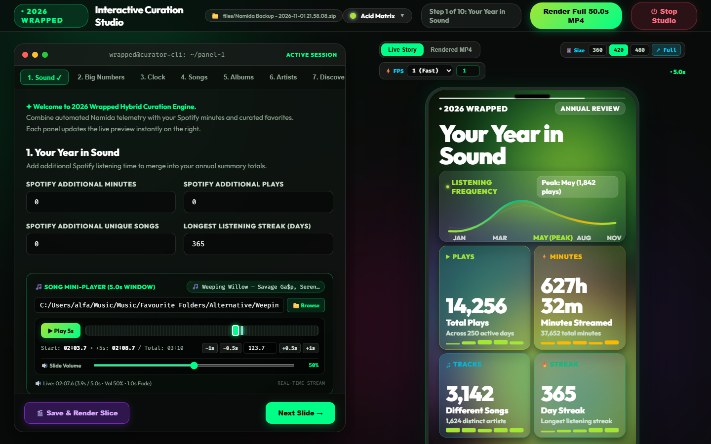
</div>

---

## Index
- [Overview](#overview)
- [Key Features](#key-features)
- [The 10 Wrapped Slides](#the-10-wrapped-slides)
- [Dynamic Background Theme & Palette Engine](#dynamic-background-theme--palette-engine)
- [Project Structure](#project-structure)
- [Prerequisites](#prerequisites)
- [Installation & Setup](#installation--setup)
- [Step-by-Step Pipeline Execution Guide](#step-by-step-pipeline-execution-guide)
  - [Step 1: Backup Preparation & Placement](#step-1-backup-preparation--placement)
  - [Step 2: Analytical Extraction & Aggregation (`analyze`)](#step-2-analytical-extraction--aggregation-analyze)
  - [Step 3: Interactive Curation & Spotify Integration](#step-3-interactive-curation--spotify-integration)
    - [Option A: Split-Screen Web Studio (`run_ui.bat` / `studio`)](#option-a-split-screen-web-studio-run_uibat--studio)
    - [Option B: Interactive CLI Wizard (`configure`)](#option-b-interactive-cli-wizard-configure)
  - [Step 4: Background Color Palette Customization](#step-4-background-color-palette-customization)
  - [Step 5: Storyboard Compilation (`generate`)](#step-5-storyboard-compilation-generate)
  - [Step 6: High-Definition Slide Keyframe Previews (`preview`)](#step-6-high-definition-slide-keyframe-previews-preview)
  - [Step 7: Slices Auditioning & Custom Video Composition](#step-7-slices-auditioning--custom-video-composition)
  - [Step 8: Full 50.0s MP4 Video Rendering (`render`)](#step-8-full-500s-mp4-video-rendering-render)
  - [Step 9: Complete One-Shot Execution (`all`)](#step-9-complete-one-shot-execution-all)
- [Audio & Video Specifications](#audio--video-specifications)
- [FLAC Metadata & Cover Art Extraction Engine](#flac-metadata--cover-art-extraction-engine)
- [Configuration Reference](#configuration-reference)
- [FastAPI REST API Reference](#fastapi-rest-api-reference)
- [Troubleshooting](#troubleshooting)
- [License](#license)

---

## Overview

Modern music listeners rarely use a single ecosystem: high-resolution lossless audio is often stored locally and played through advanced offline Android players like Namida, while commute streaming and fresh discoveries happen on platforms like Spotify.

Standard streaming year-in-review features ignore local audio entirely. This project bridges the gap:

1. **Raw Telemetry Extraction**: Unpacks zipped Namida Android backups (`LOCAL_FILES.zip` SQLite databases, `TEMPDIR_History.zip` epoch-day play event logs, and `TEMPDIR_Artworks.zip` palettes and artist/album covers).
2. **Normalization & Aggregation**: Strips playlist re-ranking prefixes, normalizes titles, resolves artist pairings, and calculates annual headline metrics (total minutes, play counts, variety, streaks, and hourly chronotypes).
3. **Cross-Platform Curation**: Seamlessly augments metrics with Spotify listening minutes (not hours), work-hour distribution (7:00 AM – 3:00 PM), Saturday release spikes, and user-curated selections for Top Songs, Albums, Artists, Discoveries, and Genres.
4. **Interactive Web Studio**: A dual-pane browser studio featuring a terminal-like console on the left (with real-time FLAC tag/cover extraction and soundtrack offset auditioning) and an interactive 9:16 smartphone player / on-demand FFmpeg MP4 slice renderer on the right.
5. **Dynamic Theme Engine**: Live background palette switcher with 5 curated themes plus custom hex pickers for primary, secondary, and accent ambient glows.
6. **Deterministic Video Rendering**: Puppeteer controls headless Google Chrome via deterministic frame-stepping (`window.seek(t)`), piping raw RGBA frames directly into FFmpeg to produce a pristine 1080x1920 @ 25 FPS MP4 video with synced, looped soundtrack audio.

---

## Key Features

- **Split-Screen Web Studio (`main.py studio` / `run_ui.bat`)**:
  - **Left Pane (Terminal Console)**: Step-by-step interactive configuration forms for all 10 panels, dark glassmorphism styling, and automatic FLAC metadata extraction.
  - **Right Pane (9:16 Device Mockup)**:
    - *Live Interactive Story*: Real-time HTML5 timeline loop clamped to the active panel or full presentation with zero encoding delay.
    - *Rendered MP4 Video*: Native HTML5 video player playing back exact FFmpeg-rendered slices or custom export sequences.
- **Dynamic Background Theme & Palette Engine**:
  - Switch between 5 rich palettes (**Spotify Aurora**, **Cyberpunk Neon**, **Sunset Solstice**, **Midnight Abyss**, **Acid Matrix**) or customize individual primary, secondary, and accent colors with live color pickers.
  - Changes instantly update CSS variables and recompile `story.html` without reloading the server.
- **Punchy Editorial Typography**:
  - High typographic hierarchy (120px–124px hero titles, 110px–148px key metrics, 34px–48px labels and subtexts).
  - High-contrast letterforms readable from across the room and on mobile devices.
  - Clean, professional design: **100% free of emojis**.
- **FLAC Vorbis Tag & Cover Art Autoloader**:
  - Pointing to local `.flac` files automatically parses Vorbis tags (`TITLE`, `ARTIST`, `ALBUM`) and embedded high-resolution front covers using `mutagen`, converting them into base64 data URIs.
- **Custom Slices Reordering & Composer**:
  - Reorder, include, or exclude slides in real time and export tailored video summaries (`output/renders/wrapped_custom_export.mp4`).
- **Native OS File Explorer Integration**:
  - Native Windows File Explorer dialogs for audio file selection and custom export destinations.
- **Deterministic Audio-Looped MP4 Output**:
  - Exactly 50.0 seconds total runtime across 10 slides (5.0s per slide).
  - FFmpeg `-stream_loop -1` seamlessly loops background soundtrack audio (`soundtrack.aac`), finishing with a 2.0-second smooth fade-out.

---

## The 10 Wrapped Slides

Each slide runs for **5.0 seconds** (0.65s staggered entrance, 3.80s living dynamic motion, 0.55s smooth exit), totaling **50.0 seconds** (1,250 frames @ 25 FPS):

| # | Slide Name | Visual Highlights | Key Data Displayed |
|---|---|---|---|
| **1** | **Your Year in Sound** | Harmonic frequency waveform with 12-month timeline markers (`JAN`, `MAR`, `MAY (PEAK)`) & 4 Bento pods | Total Plays, Minutes Streamed, Different Songs, Longest Day Streak |
| **2** | **The Big Numbers** | 28-channel live audio equalizer stream & hero metric card | Total Listening Time, Total Plays, Different Songs, Daily Average (`min/day`), Worldwide Listener Tier |
| **3** | **Listening Clock** | 24-hour radial compass with workday bridge (7 AM – 3 PM) & weekly equalizer | Peak Hour, Workday listening share, Weekly rhythm with Wednesday and Saturday spikes |
| **4** | **Top Songs** | Spinning vinyl disc with high-res cover + curated 1..5 ranking | Top 5 curated songs with titles, artists, and embedded FLAC front covers |
| **5** | **Top Albums** | Spinning purple vinyl disc + curated 1..5 album grid | Top 5 albums, artist names, and album artwork |
| **6** | **Top Artists** | Pulsating avatar glow + ranking cards | Top 5 curated artists with portraits resolved from Namida archives |
| **7** | **Top Discoveries** | Magenta neon halo & new artist discovery cards | 5 breakthrough artists discovered during the year |
| **8** | **Top Genres** | Hero #1 spotlight card + 4 sub-genre cards with cover art & artists | Top 5 curated genres paired with representative tracks, artists, and FLAC covers |
| **9** | **Most Listened Songs** | Spotlight card with vinyl record + telemetry pills | Top 5 streamed songs from raw Namida logs with exact play counts and minutes |
| **10** | **Most Listened Artists** | Avatar spotlight + streaming metric pills | Top 5 streamed artists from raw Namida logs with exact play counts and minutes |

---

### Slide 1: Your Year in Sound
<p align="center">
  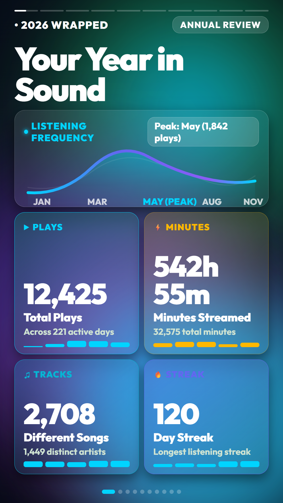
</p>

- **Motion & Layout**: Smooth cubic-bezier harmonic frequency waveform across a 12-month horizontal axis, animated peak month pill (`MAY (PEAK)`), and 4 glassmorphic Bento metric pods.
- **Data Displayed**: Total Plays, Total Minutes Streamed, Unique Songs Count, and Longest Daily Listening Streak.

---

### Slide 2: The Big Numbers
<p align="center">
  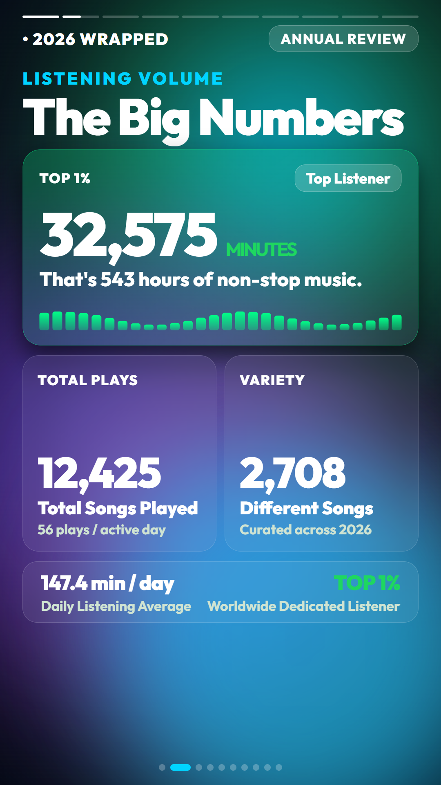
</p>

- **Motion & Layout**: 28-channel animated SVG equalizer stream, prominent $148\text{px}$ hero metric card, twin secondary metric cards, and a daily listening rhythm banner.
- **Data Displayed**: Total Listening Time, Total Plays, Different Songs, Daily Listening Average (`147.4 min / day`), and Worldwide Listener Tier status (`Top 0.05% Listeners Worldwide`).

---

### Slide 3: Listening Clock
<p align="center">
  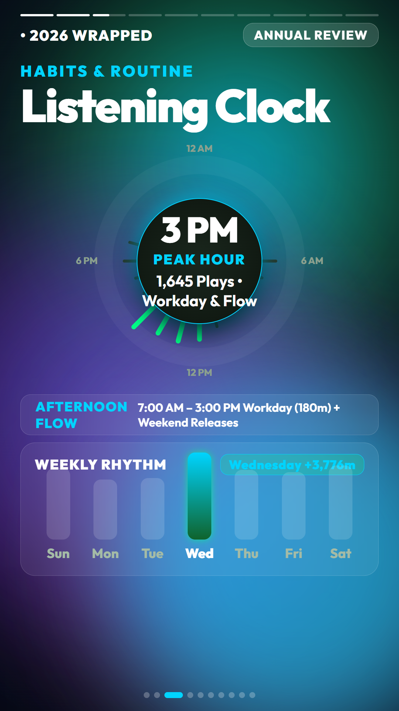
</p>

- **Motion & Layout**: 24-hour radial clock compass with golden chronotype indicator, 7-day weekly equalizer bars, and workday listening share card.
- **Data Displayed**: Peak Listening Hour, Workday Share (equidistributed across 7:00 AM – 3:00 PM), Chronotype profile (`Night Owl`), and Weekly Rhythm Spikes (`Wednesday & Saturday Releases`).

---

### Slide 4: Top Songs
<p align="center">
  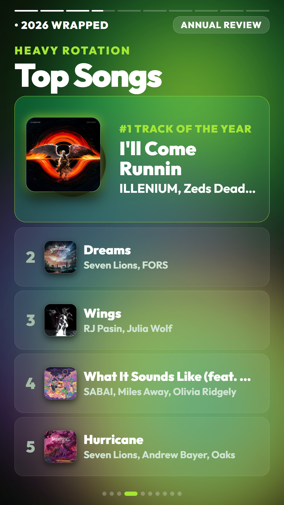
</p>

- **Motion & Layout**: Spinning vinyl record with tone arm and high-resolution album artwork center label, followed by a curated #1 through #5 ranking list.
- **Data Displayed**: Top 5 Curated Favorite Songs with track title, artist name, and embedded FLAC front cover art.

---

### Slide 5: Top Albums
<p align="center">
  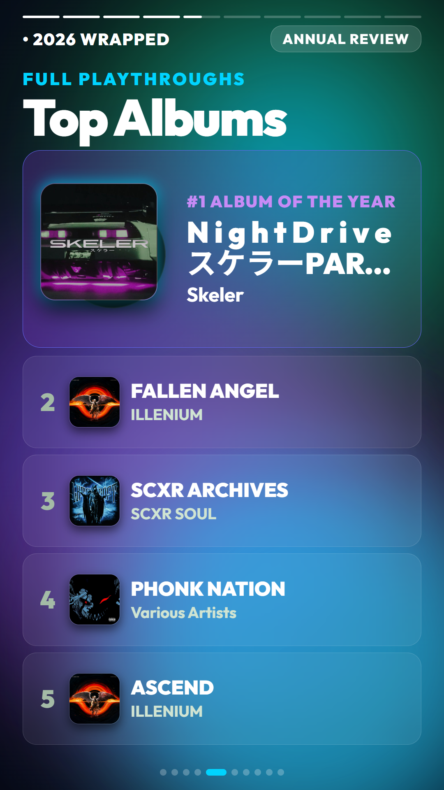
</p>

- **Motion & Layout**: Large purple vinyl disc showcase with album cover center, paired with 4 glassmorphic supporting album cards.
- **Data Displayed**: Top 5 Curated Albums with album title, release year, artist credits, and cover art.

---

### Slide 6: Top Artists
<p align="center">
  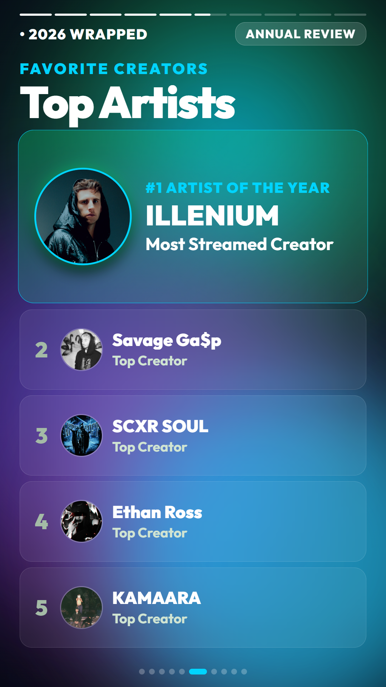
</p>

- **Motion & Layout**: Circular hero artist portrait with chromatic aberration glow and `#1 ARTIST` ribbon, accompanied by #2 through #5 artist cards.
- **Data Displayed**: Top 5 Favorite Artists with circular avatars resolved automatically from the Namida artist backup database.

---

### Slide 7: Top Discoveries
<p align="center">
  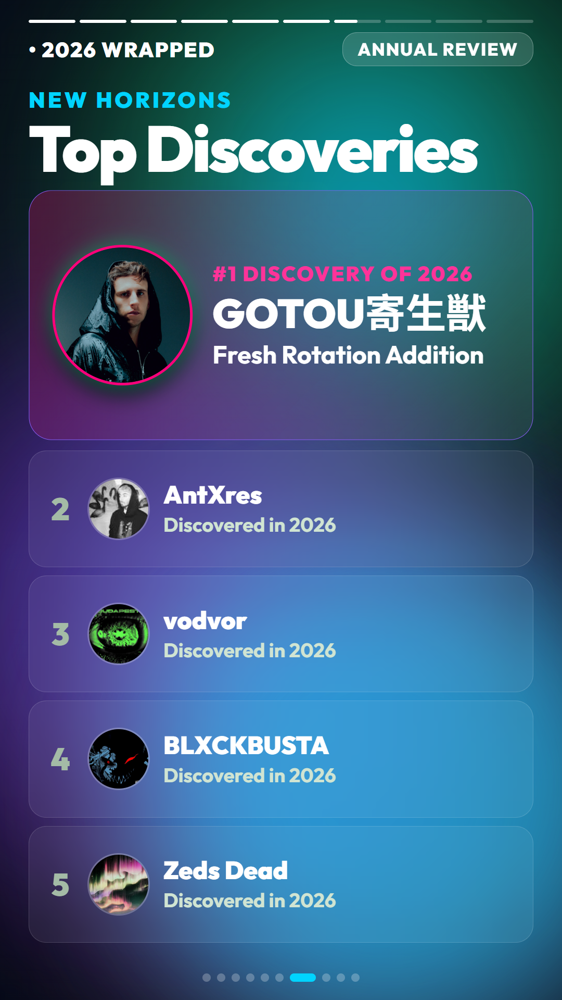
</p>

- **Motion & Layout**: Magenta neon halo spotlight, discovery year badge, and 5 breakout artist discovery cards.
- **Data Displayed**: 5 Breakthrough Creators and Artists discovered and added to playback rotation during 2026.

---

### Slide 8: Top Genres
<p align="center">
  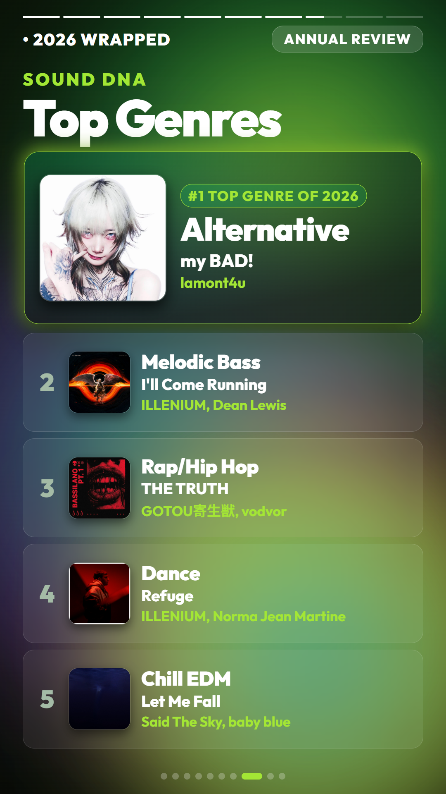
</p>

- **Motion & Layout**: Hero spotlight card for #1 Top Genre with high-res cover art and glassmorphic breathing pulse, paired with 4 staggered sub-genre cards displaying cover art, track titles, and artist credits.
- **Data Displayed**: Top 5 Music Genres paired with representative tracks, artist names, and album cover art.

---

### Slide 9: Most Listened Songs (Namida Telemetry)
<p align="center">
  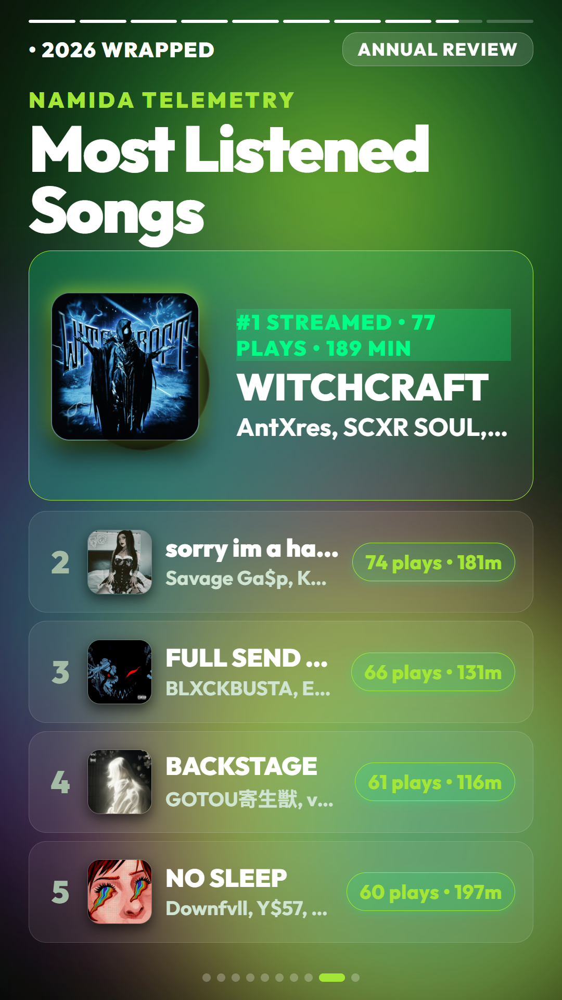
</p>

- **Motion & Layout**: Spotlight card with vinyl record, rank indicator pills, and exact telemetry listening counters.
- **Data Displayed**: Top 5 Streamed Songs from raw Namida playback logs with exact play counts and accumulated listening minutes.

---

### Slide 10: Most Listened Artists (Namida Telemetry)
<p align="center">
  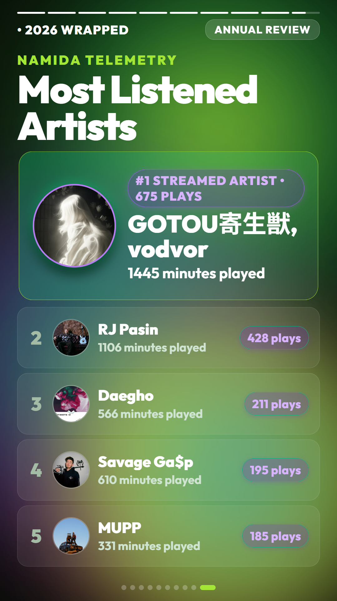
</p>

- **Motion & Layout**: Hero avatar spotlight with neon border glow, verified telemetry badges, and stacked artist stream ranking pills.
- **Data Displayed**: Top 5 Streamed Artists computed directly from SQLite play events with total plays and streaming minutes.

---

## Dynamic Background Theme & Palette Engine

Customize the mood and visual identity of the entire video presentation directly from the Web Studio header or via the REST API (`POST /api/theme`):

| Palette Name | Primary Glow | Secondary Glow | Accent Glow | Tertiary Tone | Aesthetic Mood |
|---|---|---|---|---|---|
| **Spotify Aurora** *(Default)* | `#00ff87` | `#7928ca` | `#ff007a` | `#00d4ff` | Iconic Spotify Wrapped emerald, royal indigo, and pink |
| **Cyberpunk Neon** | `#a855f7` | `#ff007a` | `#00f5ff` | `#3b82f6` | High-energy electric purple, magenta, and cyber cyan |
| **Sunset Solstice** | `#ff7a00` | `#ff0055` | `#ffb800` | `#7928ca` | Warm solar amber, neon coral, and golden sunrise |
| **Midnight Abyss** | `#00d4ff` | `#6366f1` | `#8b5cf6` | `#06b6d4` | Deep twilight ice cyan, royal indigo, and amethyst |
| **Acid Matrix** | `#a3e635` | `#10b981` | `#eab308` | `#06b6d4` | Electric acid lime, ultra emerald, and obsidian |
| **Custom Palette** | *User-defined* | *User-defined* | *User-defined* | *User-defined* | Full control via native browser color pickers |

---

## Project Structure

```
NamidaWrapped/
├── Files/                                 # User backup archives & input media (git-ignored)
│   └── .gitkeep
├── img/                                   # High-resolution screenshots and visual previews
│   ├── web_studio_preview.png             # Split-screen Web Studio dashboard preview
│   └── story_slide1.png .. story_slide10.png # Vertical captures for all 10 story slides
├── output/                                # Generated manifests, audio, storyboards, and MP4s
│   ├── .gitkeep
│   ├── artworks/                          # Extracted artist portraits and album artwork
│   ├── audio/                             # Soundtrack audio files
│   ├── data/                              # Telemetry stats, user curation JSON, and panel configs
│   ├── logs/                              # Studio background server logs
│   ├── previews/                          # Static keyframe screenshots of all slides
│   ├── renders/                           # Full-length rendered MP4 videos
│   ├── slices/                            # Per-panel and sequence MP4 slice videos
│   └── storyboard/                        # Compiled story.html and artworks.json
├── src/
│   ├── analyzer/                          # Telemetry extraction & normalization
│   │   ├── extractor.py                   # ZIP stream reader (SQLite & JSON history)
│   │   ├── normalizer.py                  # Playlist prefix stripper & track resolver
│   │   └── stats.py                       # Metric aggregator (minutes, plays, streaks, chronotypes)
│   ├── curator/                           # User curation engines
│   │   ├── flac_inspector.py              # Mutagen-based FLAC Vorbis & cover parser
│   │   └── wizard.py                      # Interactive CLI curation wizard
│   ├── renderer/                          # Headless Chrome & FFmpeg video pipeline
│   │   ├── preview_engine.js              # Keyframe screenshot capture script
│   │   └── render_engine.js               # Frame-by-frame Puppeteer-to-FFmpeg pipeline
│   ├── server/                            # Interactive Web Studio (FastAPI)
│   │   ├── app.py                         # REST API endpoints & static mounts
│   │   ├── models.py                      # Pydantic V2 request & response schemas
│   │   ├── service.py                     # Curation state management & rendering coordinator
│   │   └── static/                        # Web Studio frontend
│   │       ├── app.js                     # Client state, live sync, timeline scrubber & theme picker
│   │       ├── index.html                 # Split-screen terminal and 9:16 preview player
│   │       └── styles.css                 # Glassmorphic dark studio styling
│   ├── templates/                         # HTML5, CSS Aurora mesh, and animation engine
│   │   ├── animations.js                  # Deterministic window.seek(t) animation orchestrator
│   │   ├── builder.py                     # HTML5 storyboard compiler injecting metrics & themes
│   │   └── styles.css                     # Neon aurora gradients, fluid responsive layouts
│   ├── config.py                          # Centralized paths, video constants, and year config
│   └── __init__.py
├── main.py                                # Unified CLI entry point
├── setup.bat                              # One-click automated setup & prerequisite installer
├── setup_wizard.py                        # Standalone setup wizard entry point
├── run_ui.bat                             # One-click Windows Web Studio launcher (with auto-setup)
├── package.json                           # Node.js dependencies (puppeteer-core)
├── requirements.txt                       # Python dependencies (FastAPI, mutagen, Pillow, etc.)
└── README.md                              # Complete pipeline documentation
```

---

## Prerequisites

Ensure the following tools are installed:

1. **Python 3.10+** (Python 3.13 tested):
   ```bash
   python --version
   ```
2. **Node.js 18+** & **npm**:
   ```bash
   node --version
   npm --version
   ```
3. **FFmpeg**: Must be available in your system `PATH`. Verify with:
   ```bash
   ffmpeg -version
   ```
4. **Google Chrome**: Default installation path configured at `C:\Program Files\Google\Chrome\Application\chrome.exe` (customizable in `src/config.py`).

---

## Installation & Setup

### Fast Automated Setup (Recommended)

Simply double-click or run `setup.bat` on Windows (or run `python main.py setup` / `python setup_wizard.py` on Linux/macOS):

```bash
setup.bat
```

The interactive setup wizard automatically:
1. **Verifies System Tools**: Validates Python 3.10+, FFmpeg, Node.js, npm, and Google Chrome availability.
2. **Initializes Virtual Environment**: Detects or prompts to create an isolated `.venv`.
3. **Installs Python Dependencies**: Upgrades pip and runs `pip install -r requirements.txt`.
4. **Installs Node.js Dependencies**: Runs `npm install` for Puppeteer.
5. **Bootstraps Folders**: Prepares `files/` and all `output/` subdirectories (`audio/`, `previews/`, `renders/`, `storyboard/`).
6. **Offers Immediate Launch**: Asks whether to start the Web Studio right away.

*(Note: `run_ui.bat` also automatically launches `setup.bat` if it detects missing dependencies or an uninitialized environment).*

---

### Manual Setup

If you prefer to configure the environment manually:

1. **Clone the repository**:
   ```bash
   git clone https://github.com/albertnica/NamidaWrapped.git
   cd NamidaWrapped
   ```

2. **Create and activate a Python virtual environment**:
   ```bash
   python -m venv .venv
   # Windows (PowerShell):
   .\.venv\Scripts\Activate.ps1
   # Linux / macOS:
   source .venv/bin/activate
   ```

3. **Install Python dependencies**:
   ```bash
   pip install -r requirements.txt
   ```

4. **Install Node.js dependencies**:
   ```bash
   npm install
   ```

---

## Step-by-Step Pipeline Execution Guide

Follow these steps to produce your complete 2026 Wrapped presentation:

### Step 1: Backup Preparation & Placement
Export your backup archive from the Namida Android app and place the `.zip` file inside the `Files/` directory:
```
Files/Namida Backup - 2026-10-03 17.42.39.zip
```
*(If your backup has a different name, pass it via `--archive` during analysis).*

---

### Step 2: Analytical Extraction & Aggregation (`analyze`)
Parse the SQLite database and epoch-day play history logs to compute your baseline statistics:
```bash
python main.py analyze
```
To specify a custom archive path or target year:
```bash
python main.py analyze --archive "Files/CustomBackup.zip" --year 2026
```
This generates `output/data/wrapped_stats_2026.json` containing total plays, minutes, artist counts, active days, listening streaks, hourly distribution, and top tracks.

---

### Step 3: Interactive Curation & Spotify Integration

You can curate your presentation using either the **Web Studio** (recommended) or the **CLI Wizard**.

#### Option A: Split-Screen Web Studio (`run_ui.bat` / `studio`)
Launch the interactive browser studio:
```bash
# Double-click run_ui.bat or execute:
run_ui.bat

# Or directly via Python:
python main.py studio
```
The studio will automatically open in your default browser at **`http://127.0.0.1:8000`**.

- **Panel 1 (Your Year in Sound)**: Enter additional Spotify minutes, plays, unique songs, and your longest listening streak.
- **Panel 2 (The Big Numbers)**: Customize listener tier notes and review your daily average.
- **Panel 3 (Listening Clock)**: Set workday listening minutes (equidistributed between 7:00 AM and 3:00 PM) and Saturday release spikes.
- **Panel 4 (Top Songs)**: Enter local `.flac` file paths. Embedded metadata and front covers are extracted automatically.
- **Panel 5 (Top Albums)**: Enter local `.flac` paths or album names to resolve covers.
- **Panel 6 (Top Artists)**: Enter your favorite creators (defaults to `ILLENIUM` for #1). Portraits are matched from the Namida archive.
- **Panel 7 (Top Discoveries)**: Enter artists discovered during 2026.
- **Panel 8 (Top Genres)**: Curate your top 5 genres, representative tracks, and artists.
- **Panels 9 & 10 (Namida Most Listened)**: Review automated telemetry rankings for songs and artists.

Each change instantly updates the live preview on the right.

#### Option B: Interactive CLI Wizard (`configure`)
If you prefer a terminal-only experience:
```bash
python main.py configure
```
Prompts for Spotify additions, workday minutes, and curated favorites, saving results to `output/data/user_curation_2026.json`.

---

### Step 4: Background Color Palette Customization
In the Web Studio top navigation bar, click the **Palette Selector** button (`Spotify Aurora ▼`):
- Click any preset (**Spotify Aurora**, **Cyberpunk Neon**, **Sunset Solstice**, **Midnight Abyss**, **Acid Matrix**) to immediately transform the color scheme.
- Use the **Custom Glow Pickers** to select specific hex colors for primary, secondary, and accent glows.
- The live preview player updates in real time, and the chosen palette is automatically baked into video renders.

---

### Step 5: Storyboard Compilation (`generate`)
Compile the full-bleed HTML5 DOM combining metrics, curated assets, themes, and animations:
```bash
python main.py generate
```
Builds `output/storyboard/story.html` with all base64 artwork, fonts, and inline CSS/JS.

---

### Step 6: High-Definition Slide Keyframe Previews (`preview`)
Capture static 1080x1920 test screenshots of every slide to visually verify styling and layout:
```bash
python main.py preview
```
Screenshots are written to `output/previews/`:
- `slide_1_year_in_sound.jpg`
- `slide_2_big_numbers.jpg`
- `slide_3_listening_clock.jpg`
- `slide_4_top_songs.jpg`
- `slide_5_top_albums.jpg`
- `slide_6_top_artists.jpg`
- `slide_7_top_discoveries.jpg`
- `slide_8_top_genres.jpg`

---

### Step 7: Slices Auditioning & Custom Video Composition
Inside the Web Studio:
- **Audio Auditioning**: Test slide soundtracks, adjust start offsets, and preview transitions in the browser before rendering.
- **Custom Slices Reordering**: Open the **Custom Slices & Order** drawer at the bottom right. Drag or toggle checkboxes to select which slides to include and their playback sequence.
- **Render Custom Sequence**: Click **Render Custom Video Now** to render your personalized slice sequence to `output/renders/wrapped_custom_export.mp4`.
- **Export to Custom Path**: Use the **Browse...** button to select any destination on your hard drive via Windows File Explorer and click **Save Video**.

---

### Step 8: Full 50.0s MP4 Video Rendering (`render`)
Render the complete 50-second, 1080x1920 vertical MP4 video:
```bash
python main.py render
```
- Spawns headless Google Chrome with a 1080x1920 viewport.
- Seeks frame-by-frame across 1,250 frames @ 25 FPS using `window.seek(t)`.
- Pipes raw RGBA frame streams directly into FFmpeg with looped soundtrack audio.
- The final video is written to: **`output/renders/wrapped_2026.mp4`**.

---

### Step 9: Complete One-Shot Execution (`all`)
To run the entire pipeline (analysis, generation, and rendering) end-to-end in one command:
```bash
python main.py all
```

---

## Audio & Video Specifications

| Parameter | Value | Details |
|---|---|---|
| **Resolution** | 1080 x 1920 | Standard 9:16 vertical smartphone aspect ratio |
| **Framerate** | 25 FPS | Deterministic frame-stepping via Puppeteer |
| **Duration** | 50.0 seconds | 10 slides @ 5.0 seconds each |
| **Total Frames** | 1,250 frames | Exact frame calculation (`50.0 * 25`) |
| **Video Codec** | H.264 (`libx264`) | Pixel format `yuv420p`, CRF 19, preset `fast` |
| **Audio Codec** | AAC | Bitrate 256 kbps, stereo |
| **Audio Looping** | `-stream_loop -1` | Continuous soundtrack loop with 2.0s fade-out at `st=48.0` |

---

## FLAC Metadata & Cover Art Extraction Engine

The curation engine uses `mutagen` to inspect local FLAC files directly:
- **Vorbis Tags**: Reads standard tags `TITLE`, `ARTIST`, and `ALBUM`.
- **Embedded Cover Art**: Reads `FLAC.pictures` for `PictureType.COVER_FRONT` (type 3).
- **Inline Conversion**: Converts raw image bytes into base64 Data URIs (`data:image/png;base64,...`) for offline DOM rendering.
- **Resilience**: If a FLAC file lacks embedded artwork, the system automatically falls back to clean SVG gradient avatars so rendering never fails.

---

## Configuration Reference

Key paths and video parameters are located in `src/config.py`:

```python
# Video Specifications
VIDEO_WIDTH: int = 1080
VIDEO_HEIGHT: int = 1920
VIDEO_FPS: int = 25
VIDEO_DURATION_SEC: float = 50.0
TOTAL_FRAMES: int = int(VIDEO_DURATION_SEC * VIDEO_FPS)  # 1250 frames

# Browser Binary
CHROME_PATH: str = r"C:\Program Files\Google\Chrome\Application\chrome.exe"
```

To run on Linux or macOS, update `CHROME_PATH` (e.g. `/usr/bin/google-chrome` or `/Applications/Google Chrome.app/Contents/MacOS/Google Chrome`).

---

## FastAPI REST API Reference

The Web Studio server exposes the following REST endpoints:

| Endpoint | Method | Description |
|---|---|---|
| `/` | `GET` | Serves the split-screen Web Studio interface |
| `/story` | `GET` | Serves the compiled `story.html` for real-time iframe preview |
| `/api/status` | `GET` | Returns active panel, completion status, curation data, and video URLs |
| `/api/theme` | `GET` | Returns the active background color palette and glow hex values |
| `/api/theme` | `POST` | Updates and persists the background theme, immediately rebuilding `story.html` |
| `/api/panels/{id}` | `POST` | Submits curation data for panel `{id}` and rebuilds `story.html` |
| `/api/panels/{id}/save` | `POST` | Persists panel inputs to local configuration files |
| `/api/preview-fps` | `POST` | Configures global preview framerate (1 to 60 FPS) |
| `/api/browse-path` | `POST` | Opens native Windows File Explorer Save dialog to choose export destination |
| `/api/browse-audio` | `POST` | Opens native Windows File Explorer Open dialog to select local audio file |
| `/api/extract-flac` | `POST` | Extracts Vorbis tags and embedded cover art from a local FLAC file |
| `/api/save-video` | `POST` | Renders and saves video directly to a user-specified destination path |
| `/api/shutdown` | `POST` | Gracefully shuts down the Web Studio background server |

---

## Troubleshooting

### 1. `Cannot find Chrome binary at ...`
Ensure Google Chrome is installed. If installed in a non-default location, update `CHROME_PATH` in `src/config.py`.

### 2. `FFmpeg is not recognized as an internal or external command`
Ensure FFmpeg is installed and added to your system `PATH`. Test by running `ffmpeg -version` in a terminal.

### 3. Port 8000 already in use
`main.py studio` automatically finds and terminates any stale process bound to port 8000 using `free_port()` before starting Uvicorn. To use a different port:
```bash
python main.py studio --port 8080
```

### 4. Windows Console Unicode / Character Display
The codebase reconfigures UTF-8 standard output upon startup in `src/config.py` to guarantee clean logs on Windows PowerShell and Command Prompt.

---

## License

This project is licensed under the MIT License. See [LICENSE](LICENSE) for details.
